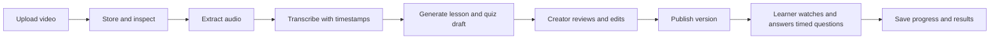

# Trainly MVP Product Requirements Document

**Status:** Draft 1  
**Date:** 2026-10-19  
**Primary stack:** Python

**Visual direction:** See [Trainly MVP visual identity](./visual_identity.md).

**Web stack:** See [Trainly MVP web stack](./web_stack.md).

**Implementation tracking:** See the [implementation checklist](./checklist.md).

## 1. Product summary

Trainly turns an existing training video into a structured learning module. A creator uploads a video, reviews a generated transcript, lesson outline, and timed quiz questions, then publishes the module for learners. Learners watch the video, answer questions at selected moments, and see their completion status.

This document makes the following working assumptions because the product details are still open:

- The first release is a browser based application for small teams.
- Uploaded videos are the source material; live recording and video editing are outside the first release.
- AI helps draft the module, but a creator approves and can edit all generated text before publication.
- A module contains one source video, ordered lessons linked to video time ranges, and quiz questions placed at selected video timestamps or at the end.
- English language videos are supported first.

## 2. Problem and outcome

Creating training material from a video takes time: someone must identify topics, write an outline, prepare questions, and track whether learners completed the training. Trainly should reduce that work while keeping the creator responsible for the final material.

**MVP outcome:** A creator can upload a supported video and publish a usable training module after reviewing an automatically prepared draft. A learner can finish that module and the creator can see the completion record.

## 3. Users and jobs

| User | Job to be done |
| --- | --- |
| Creator | Turn a video into a clear module, correct generated content, publish it, and see learner progress. |
| Learner | Follow the video in manageable lessons, check understanding, and know whether the module is complete. |
| Workspace administrator | Sign in at `/admin`, create creator and learner accounts, assign each to a workspace, and share one-time setup links. |

## 4. MVP scope

### 4.1 Creator flow

1. Sign in and create a module draft with a title and optional description.
2. Upload one video. The app validates the file type, size, and duration, stores it, and shows processing status.
3. The app extracts audio, transcribes speech with timestamps, and generates a proposed title, summary, lesson boundaries, lesson descriptions, and quiz questions with suggested playback positions.
4. Review and edit the transcript, module metadata, lesson titles and descriptions, time ranges, question positions, and answers. The creator can preview each question at its position in the video.
5. Preview the learner experience and publish the module.
6. Share a module link with users in the workspace and view completion and quiz results.

### 4.2 Learner flow

1. Sign in and open an assigned or shared published module.
2. Watch the video from the beginning or jump to a lesson's time range. Read the lesson summary.
3. At a timed checkpoint, the video pauses and shows a question over the player. Submit an answer, see feedback, and continue watching. Questions placed at the end appear after the video.
4. See completion status and return later without losing progress.

### 4.3 Functional requirements

| ID | Requirement | MVP acceptance criterion |
| --- | --- | --- |
| F1 | Account access | Users can sign in; admin, creator, and learner roles govern account management, editing, and viewing. A user cannot access another workspace's private modules. |
| F2 | Video upload | Creator can upload MP4, MOV, or WebM. The interface shows validation errors and upload or processing state. Initial limits: 1 GB and 120 minutes, configurable by deployment. |
| F3 | Processing | Each upload runs asynchronously through media inspection, audio extraction, transcription, and draft generation. Status is visible as queued, processing, ready, or failed. Failed jobs can be retried without another upload. |
| F4 | Transcript | Draft transcript has timestamps and editable text. Creator can replay the corresponding video position while reviewing it. |
| F5 | Lesson draft | Generation creates 2 to 10 ordered lessons with nonoverlapping time ranges inside the video, each with a title and short summary. Creator can add, remove, reorder, and edit lessons. |
| F6 | Quiz draft | Generation proposes 3 to 10 multiple choice questions, each with one correct answer, an explanation, and a suggested timestamp or end position. Creator can add, remove, edit, and reposition questions, including placing them from the video timeline at the current playhead. |
| F7 | Publish controls | Only a creator can publish. Publishing requires a playable video, title, at least one valid lesson, and at least one valid quiz question. Draft changes do not affect the published version until republished. |
| F8 | Learner experience | Published module displays lessons and a video player. At a question timestamp, playback pauses and an accessible question appears in the player. Submitting an answer saves it, shows feedback, and permits playback to continue. End positioned questions appear after playback. Video seeking to lesson starts works on desktop and mobile browsers. |
| F9 | Progress | App saves the last watched position, lesson completion, answers, attempts, and score. Module completion requires viewing each lesson and submitting every required question. Passing score defaults to 70% and is configurable per module. |
| F10 | Results | Creator can see assigned learners, completion state, completion time, latest score, and attempt count for each module. |
| F11 | Error handling | Unsupported files, failed transcription, failed generation, and interrupted uploads produce actionable messages. Existing draft edits remain intact when a generation step is retried. |

### 4.4 Scope boundaries

The first release excludes recording or editing video, automatic dubbing or translation, SCORM/LMS export, certificates, payment, public course marketplace, live classes, advanced analytics, and complex organizational role hierarchies. These can be revisited after the core conversion and learning flow works.

### 4.5 Implementation plan

Track completed and remaining work in the [implementation checklist](./checklist.md).

Migrate the current Python HTTP server to FastAPI now, before adding transcription, background jobs, or workspace accounts. Preserve the existing API paths and response shapes during the first migration so the browser interface continues to work. Move the current routes, authentication checks, upload handling, and authorized media streaming first. Introduce SQLAlchemy, Alembic, Jinja2 page rendering, and the worker in later, focused steps; they do not need to land in the same change as the HTTP migration.

## 5. Experience and content rules

- Generated content is labeled as a draft until the creator publishes it. The creator can inspect the supporting transcript and video time range for each lesson and question.
- If speech is absent or transcription quality is too low, the app reports that the draft needs manual review and lets the creator write lessons and quiz content.
- A lesson time range has a start before its end, fits within the video, and does not overlap another lesson. Gaps are allowed for introductions or breaks.
- Quiz questions use plain language and should test ideas in the source video. The generation prompt must avoid inventing facts outside the transcript. The creator remains able to correct errors.
- Timed questions are player overlays linked to timestamps in module data; the uploaded video file is not modified. A timed question must occur after the video segment that teaches its answer. Questions at the same timestamp appear in a defined order.
- Seeking past an unanswered required checkpoint opens that question before playback continues. On return visits, answered checkpoints do not interrupt playback again unless the learner starts a new attempt.
- Published content is versioned. Learner attempts retain the version they were taken against, so later creator edits do not rewrite past results.
- Keyboard navigation, captions from the reviewed transcript, readable contrast, and responsive layouts are required for the learner flow.

## 6. Proposed technical design

### 6.1 Components

| Component | Proposed implementation | Responsibility |
| --- | --- | --- |
| Web app and API | Python with FastAPI, Jinja2 templates, and native JavaScript modules | Accounts, module editor, learner pages, API, and authorization. |
| Background jobs | Python worker with jobs persisted in SQLite | Video inspection, audio extraction, transcription, and draft generation without blocking requests. |
| Media processing | FFmpeg invoked by the worker | Validate media, extract audio, capture duration, and prepare browser compatible playback when necessary. |
| AI services | Replaceable Python adapters for speech transcription and text generation | Keep provider choice and credentials outside product logic; store job status and errors. |
| Database | SQLite for development and MVP deployment | Users, workspaces, drafts, published versions, assignments, processing jobs, progress, and results. |
| File storage | Private directory on a persistent local volume | Source videos, derived media, and caption files. Playback uses an authenticated media route with byte range support. |

The Python API should enforce authorization for every module, media, and result request. Media processing and AI calls belong in background jobs because videos can take minutes to process. Generated content should be stored as structured data, validated, and presented for creator review. Use short SQLite transactions, write ahead logging, and a busy timeout so the API and worker can safely share the database. The MVP runs with one writable app instance and one processing worker.

### 6.2 Core data entities

| Entity | Key fields |
| --- | --- |
| Workspace | id, name |
| User and membership | id, email, workspace_id, role |
| Video asset | id, workspace_id, storage key, duration, format, upload status |
| Module | id, workspace_id, video_id, title, description, draft status, published version id |
| Transcript segment | module_id, start, end, text, source and edit status |
| Lesson | module version id, order, start, end, title, summary |
| Quiz question | module version id, prompt, options, correct option, explanation, trigger timestamp or end position, order, required flag |
| Assignment | module id, learner id, assigned date |
| Progress and attempt | learner id, module version id, position, lesson states, checkpoint answers, score, completion time |
| Processing job | video id, stage, status, retry count, error details |

### 6.3 Processing sequence

## 7. Quality, privacy, and operations

- **Reliability:** A failed processing stage records the error and can be retried. Uploading or processing does not create a partially published module.
- **Database operations:** Keep the SQLite file on a persistent local volume, back it up regularly, and restore it as part of deployment recovery. Do not place the database file on a shared network filesystem.
- **Performance:** Common editor and learner pages should load promptly on a normal broadband connection. Video playback uses streaming or range requests. Processing time depends on video length and the chosen providers; show progress stages instead of promising a fixed completion time.
- **Security:** Require authentication for private content, enforce workspace isolation, validate uploads by content and metadata, limit file size, protect provider secrets, and use HTTPS in deployment.
- **Privacy:** Tell creators that uploaded video and transcripts may be sent to configured AI providers. Define retention and deletion behavior before production launch; deleting a module must remove its private media and generated artifacts after the retention window.
- **Accessibility:** Use semantic controls, keyboard operation, visible focus, captions, and accessible quiz feedback. Target WCAG 2.2 AA for the learner experience.
- **Observability:** Record processing stage, duration, failure reason, and request errors without logging video contents or sensitive transcript text.

## 8. Success measures

| Measure | Initial target to validate in pilot |
| --- | --- |
| Draft creation | At least 80% of valid uploaded videos reach a reviewable draft without manual intervention. |
| Time saved | Median creator time from upload completion to publish is under 20 minutes for a 30 minute video. |
| Content usefulness | At least 70% of pilot creators publish after editing the generated draft. |
| Learner completion | At least 70% of assigned pilot learners complete a published module. |

Targets are hypotheses for a pilot, not launch guarantees. Record upload, processing, editing, publishing, and completion events to measure them.

## 9. Delivery sequence

1. **Foundation:** Migrate the existing HTTP routes to FastAPI while preserving browser behavior; then add workspace roles, managed accounts, schema migrations, and private video upload and playback improvements.
2. **Conversion:** Background processing, transcription, lesson and quiz generation, status and retry handling.
3. **Creator review:** Transcript and module editor, preview, validation, publish and versioning.
4. **Learner flow:** Module player, captions, timed question overlays, saved progress, assignment and results view.
5. **Pilot readiness:** Accessibility pass, persistent storage and deployment, database backup and restore, error monitoring, retention controls, and pilot measurement.

## 10. Decisions to confirm before implementation

1. **Audience:** Is the first customer an internal team, a training business, or individual creators? This affects workspace and sharing rules.
2. **AI and data handling:** Which transcription and text generation providers are acceptable, and can customer videos be sent to them?
3. **Assignment model:** Should creators invite learners by email, share a private link, or both?
4. **Assessment:** Is a passing quiz score required for completion, and should retries be limited?
5. **Hosting and limits:** Expected number of users, monthly video hours, deployment environment with persistent storage for SQLite, storage budget, and retention period.

Until these are resolved, the implementation can use provider adapters, configurable limits, and a simple workspace invite flow.
